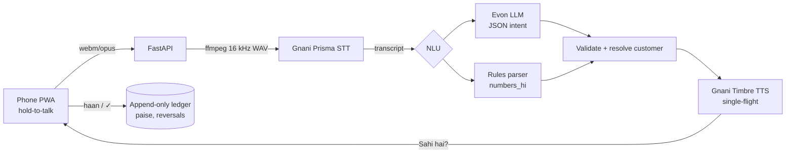

# Kirana Khata

**Bolo, aur hisaab likh jayega.** A voice-first khata (ledger) for kirana shops. Hold one big button and say *"Sharma ji ne do kilo cheeni li, ek sau bees udhaar"*. It writes the entry and speaks back the balance.

> 🚧 In progress for the Gnani AI *Great Indian AI Internship Challenge* (deadline 10 Nov 2026). Current phase: see [docs/PROGRESS.md](docs/PROGRESS.md).
> A demo GIF will go here (Phase 8).

## Built on Gnani AI

| Gnani model | Role in the loop | Where in code |
|---|---|---|
| **Prisma v3.0** (STT) | Hinglish, Hindi or Marathi speech → transcript | `backend/app/voice/gnani_stt.py` |
| **Evon v3.3 30B-A3B** (LLM) | Transcript → strict JSON intent, cross-checked by a deterministic rules parser | `backend/app/nlu/` ([docs/NLU.md](docs/NLU.md)) |
| **Timbre v3.0** (TTS, voice Shivani) | Spoken confirmation and balance ("Sahi hai?"), streamed over SSE | `backend/app/voice/gnani_tts.py` |

## Architecture



More detail: [ARCHITECTURE](docs/ARCHITECTURE.md) · [VOICE](docs/VOICE.md) · [NLU](docs/NLU.md) · [LEDGER](docs/LEDGER.md) · [API](docs/API.md) · [FRONTEND](docs/FRONTEND.md).

## Design decisions (summary)

- **Money is an integer number of paise.** The ledger is append-only, enforced by database triggers, and corrections are reversal entries. Balances are computed in SQL and property-tested against an independent model on SQLite and Postgres.
- **Nothing is written without confirmation.** The LLM's amount is only a suggestion; the rules parser checks it independently.
- **One Gnani request at a time.** The account allows 1 active request, so STT and TTS share a process-wide lock ([docs/DOC_DIFFS.md](docs/DOC_DIFFS.md)).
- **Tests never call paid APIs.** Fakes stand in for Gnani and Evon, and live calls only run under `pytest -m live` or `make smoke-voice`.

## Measured results

Only numbers that have actually been measured are listed. The rest come later (Evon accuracy, p50/p95 latency, noisy audio).

| What | Result |
|---|---|
| Rules NLU on 30 **blind holdout** utterances (first run) | 90.0% intent, 96.7% customer |
| Rules NLU on the 81-case golden set | 100% intent, 54/54 amounts |
| Amounts wrong *and* unflagged (CI gate) | 0 |
| Prisma STT v3 round trip | 518–637 ms |
| Timbre v3.0 time to first audio (SSE) | 308 ms |
| Lighthouse mobile (`/`, `/customers`) | Perf 100 · A11y 100 · Best practices 100 |

## Run locally

Prerequisites: Python 3.12 via [uv](https://docs.astral.sh/uv/), Node 20+ with pnpm 9, ffmpeg, and GNU make. On Windows, run `make` from **Git Bash**.

```bash
cp .env.example .env        # add GNANI_API_KEY; keep NLU_MODE=rules until Evon is hosted
make install
make seed                   # demo shop + customers
make dev                    # backend http://localhost:8000, frontend http://localhost:3000
make lint test              # ruff, mypy --strict, eslint, tsc, pytest, vitest
make docker-up              # backend + Postgres in Docker (prod parity)
make smoke-voice FILE=clip.webm   # live Gnani STT -> TTS round trip (spends ~2 credits)
```

| Endpoint | Purpose |
|---|---|
| `GET /api/health` | Liveness check |
| `GET /api/ready` | DB, Gnani config and Evon reachability (never spends credits) |

### Env vars

See [.env.example](.env.example). The key ones are `GNANI_API_KEY`, `GNANI_STT_MODEL=prisma-v3.0`, `GNANI_STT_LANGUAGE=hi-IN,en-IN`, `GNANI_STT_FORMAT`, `GNANI_TTS_MODEL=timbre-v3.0`, `GNANI_TTS_VOICE=Shivani`, `GNANI_CREDIT_GUARD`, `EVON_BASE_URL`, `NLU_MODE` (`rules|hybrid|evon`), `DATABASE_URL` and `JWT_SECRET`.

## Deploy (Phase 7)

The backend runs as a Docker container on Render, the frontend on Vercel (it proxies `/api/*` to the backend, so the auth cookie stays first-party), and Postgres on Neon.

## Roadmap

Phone-call channel (IVR, mulaw 8 kHz), credit scoring from udhaar history, and multi-shop support.
